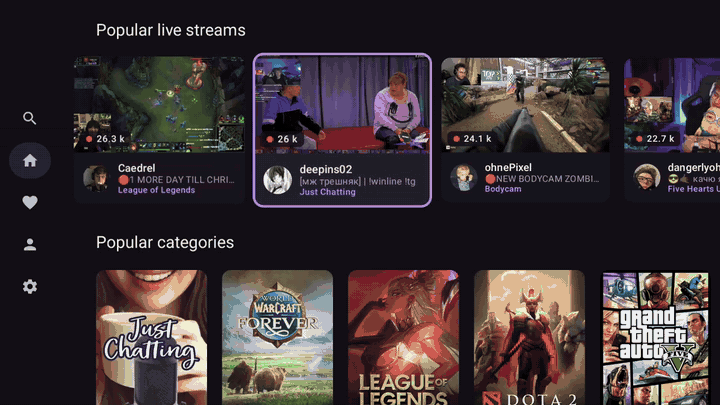
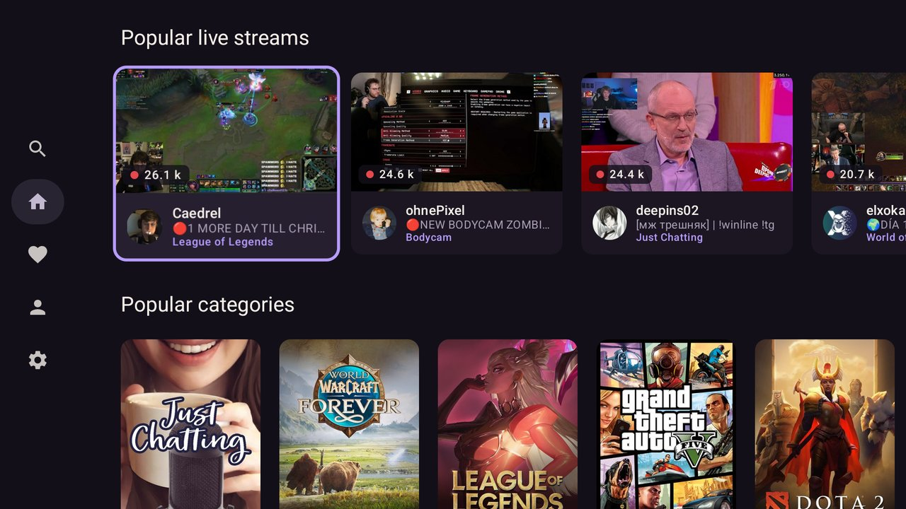
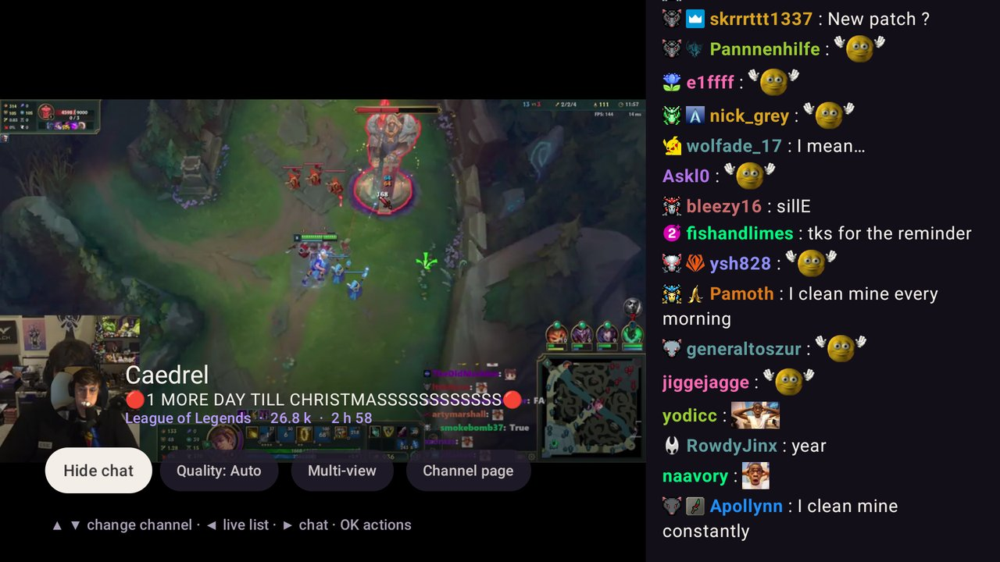
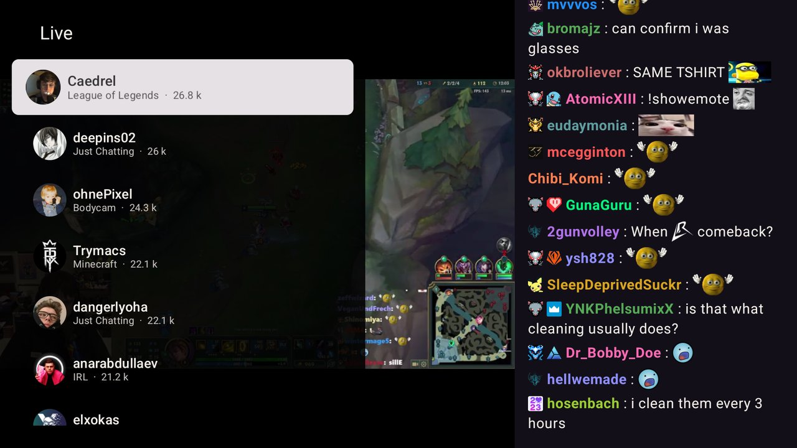
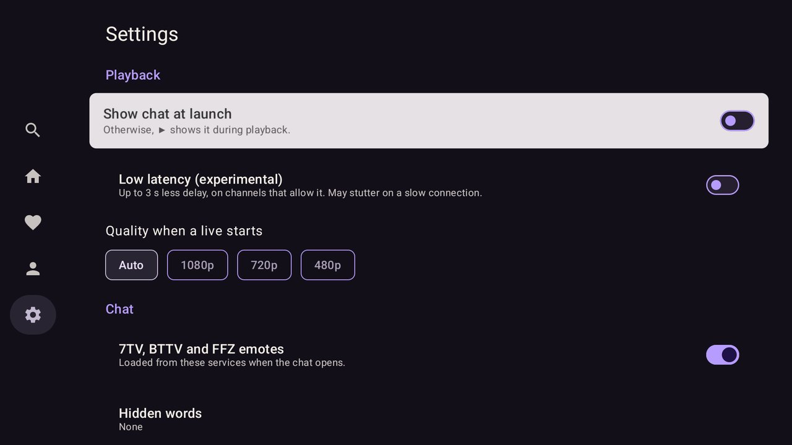

<p align="center">
  
</p>

<p align="center">
  <b>A fast, modern Twitch client for Android TV and Google TV.</b> · <a href="https://limoniak.github.io/streamsofa-tv/">Website</a><br>
  Built for the couch: remote-first navigation, readable from three meters away, quick on low-end boxes.
</p>

<p align="center">
  <a href="https://github.com/Limoniak/streamsofa-tv/releases/latest"></a>
  <a href="https://github.com/Limoniak/streamsofa-tv/actions/workflows/ci.yml"></a>
  
  <a href="LICENSE"></a>
</p>

<p align="center">
  
</p>

> [!NOTE]
> StreamSofa is an unofficial app. It is not affiliated with, endorsed by or sponsored by Twitch Interactive, Inc.

## Features

| | |
|---|---|
| **Watch** | Live streams with quality selection and fast channel zapping, an experimental low-latency mode, audio only, a sleep timer, picture-in-picture. Past broadcasts that remember where you stopped, with chapters and playback speed. Clips. |
| **Multi-view** | Two to four streams side by side, on devices that can decode them. Sound follows the focused tile; any tile can be replaced. |
| **Chat** | Read and send messages, replies, an emote picker, badges, 7TV / BTTV / FFZ emotes (animated where the device allows), hidden words and users. Text size, width, or on top of the video. Polls and predictions, read-only. Chat replay on past broadcasts. |
| **Accounts** | Sign in by entering a code on your phone, no typing on the TV. Several accounts, plus a guest mode that needs no account at all. |
| **Discover** | Followed channels first, recommendations, popular streams and categories, a language filter, search. Top clips per category and from the channels you follow. |
| **Android TV** | "Continue watching" and "Live channels you follow" rows, global and voice search, `twitch.tv` links open in the app. |
| **Raids** | When the channel you watch raids, a banner offers to follow it. |

The interface is in English and French and follows the system language. On Android 13 and later it can also be set for the app alone in the Android settings.

Ads inserted by Twitch play as usual: StreamSofa never blocks them and never tries to unlock subscriber or Turbo perks.

What could come next is listed in the [roadmap](ROADMAP.md).

## Screenshots

| | |
|---|---|
|  |  |
| **Home**: followed channels first, then popular streams and categories. | **Player**: OK opens the action bar, Right shows the chat. |
|  |  |
| **Live list**: Left opens it, Up and Down change channel directly. | **Settings**: chat, quality, low latency, accent color, updates. |

## Install

StreamSofa is distributed as an APK on [GitHub Releases](https://github.com/Limoniak/streamsofa-tv/releases/latest), outside the Play Store.

| Your device | APK to download |
|---|---|
| Most recent boxes and TVs (Chromecast with Google TV, Shield, ...) | `streamsofa-<version>-arm64-v8a.apk` |
| Older or 32-bit boxes (Mi Box S, ...) | `streamsofa-<version>-armeabi-v7a.apk` |
| Not sure | `streamsofa-<version>-universal.apk` |

**On the TV**: install the free *Downloader* app, allow it to install unknown apps (Settings → Apps → Security), then type `limoniak.github.io/streamsofa-tv/get`: it downloads the latest universal APK.

**From a computer**, with developer options and network debugging enabled on the TV:

```bash
adb connect <tv-ip-address>
adb install streamsofa-<version>-universal.apk
```

Once installed, StreamSofa checks for a new version at each launch and offers to download it; Android then asks you to confirm the install. The check can be turned off in *Settings → Updates*.

## Build from source

StreamSofa has a Rust core (Twitch APIs, chat, playlists, storage) exposed to a Kotlin / Jetpack Compose for TV app through [UniFFI](https://mozilla.github.io/uniffi-rs/).

```
rust/core            lumen-core: auth, accounts, Helix and GQL clients, chat (IRC), emotes, HLS, SQLite store, updates
android/core-bridge  builds the native library (cargo-ndk, 3 ABIs) and generates the Kotlin bindings
android/data         repositories, Hilt modules, Keystore-backed secret storage
android/feature/*    auth, home, player, settings
android/designsystem theme, colors, cards, overscan margins
android/app          single Activity and navigation
```

### Requirements

- JDK 21, Android SDK (platform 37), NDK `29.0.14206865`
- Rust stable with the Android targets and cargo-ndk:

  ```bash
  rustup target add aarch64-linux-android armv7-linux-androideabi x86_64-linux-android
  cargo install cargo-ndk --locked
  ```

- A Twitch application registered on the [Twitch developer console](https://dev.twitch.tv/console/apps), client type **Public**.

Copy `android/local.properties.example` to `android/local.properties` and fill in the SDK path and `twitch.clientId`.

### Build and run

```bash
cd android && ./gradlew :app:assembleDebug
adb install -r app/build/outputs/apk/debug/app-universal-debug.apk
```

To iterate faster on a single device, build one ABI only: `./gradlew :app:assembleDebug -Plumen.abis=arm64-v8a`.

### Tests

```bash
cd rust && cargo test
cd android && ./gradlew :core-bridge:testDebugUnitTest :data:testDebugUnitTest :feature:auth:testDebugUnitTest :feature:player:testDebugUnitTest
```

The `core-bridge` tests load the Rust core built for the host machine, so they check the Kotlin ⇄ Rust bridge without a device.

## Releasing

CI (`.github/workflows/ci.yml`) runs the tests on every push. Pushing a `vX.Y.Z` tag also builds signed APKs and publishes a GitHub release; the app version comes from the tag and the release notes from the matching section of [`CHANGELOG.md`](CHANGELOG.md). A tag with a suffix (`v0.3.0-beta.1`) publishes a pre-release, offered only to users who turned on "Beta versions".

1. Create the release key once and **keep it safe**: without it, no future update can be installed over existing installs.

   ```bash
   keytool -genkeypair -v -keystore streamsofa-release.jks -alias streamsofa -keyalg RSA -keysize 4096 -validity 10000 -dname "CN=StreamSofa"
   ```

2. Add the repository secrets (Settings → Secrets and variables → Actions):
   `TWITCH_CLIENT_ID`, `LUMEN_KEYSTORE_BASE64` (output of `base64 -w0 streamsofa-release.jks`),
   `LUMEN_KEYSTORE_PASSWORD`, `LUMEN_KEY_ALIAS`, `LUMEN_KEY_PASSWORD`.
3. Move the `Unreleased` entries of the changelog under the new version, then tag: `git tag v0.2.0 && git push origin v0.2.0`.

Locally, an `android/keystore.properties` file (`storeFile`, `storePassword`, `keyAlias`, `keyPassword`) signs `assembleRelease` with the same key; without it, release builds use the debug key.

The Baseline Profile (faster startup and scrolling) should be regenerated when the UI changes a lot, with an emulator or a box connected. The app is uninstalled at the end, so accounts and resume positions on that device are lost. With several devices connected, pick one with `ANDROID_SERIAL`.

```bash
cd android && ./gradlew :app:generateBaselineProfile -Plumen.abis=x86_64
```

## Credits

- Wordmark set in [Fraunces](https://github.com/undercasetype/Fraunces) (SIL Open Font License), converted to vector paths.
- Third-party emotes from [7TV](https://7tv.app), [BetterTTV](https://betterttv.com) and [FrankerFaceZ](https://www.frankerfacez.com).
- Twitch is a trademark of Twitch Interactive, Inc.

## License

StreamSofa is free software, released under the [GNU General Public License v3.0 or later](LICENSE).
